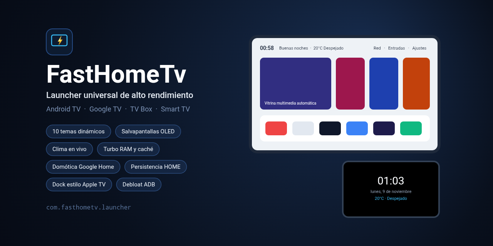

# FastHomeTv (`com.fasthometv.launcher`)

  

**FastHomeTv** es un Launcher universal de alto rendimiento para **Android TV, Google TV, TV Box y Decodificadores (como Deco Mundo GO)**, diseñado con una arquitectura híbrida inspirada en [Gathin23/cleanyourtv](https://github.com/Gathin23/cleanyourtv) y [simbasjungles/free-my-tv](https://github.com/simbasjungles/free-my-tv).

## Capturas de Pantalla

  
  

  
  

  
  

## Características Principales
- **Identidad Visual Única (`FastHomeTv` • `com.fasthometv.launcher`)**: Ícono vectorial exclusivo ([`ic_launcher.xml`](app/src/main/res/drawable/ic_launcher.xml)) y banner `16:9` nativo para Android TV ([`ic_banner.
